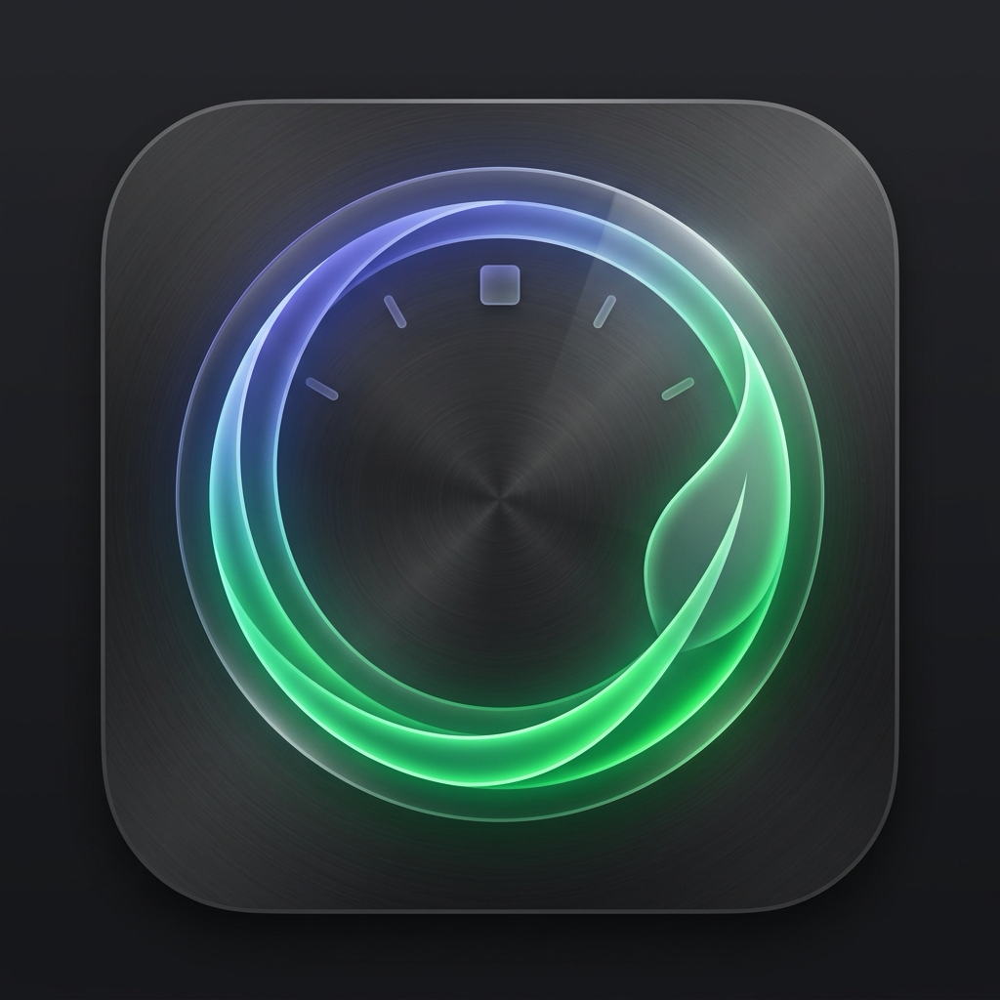

# circleOne 🌿 — Modern iOS Leave Application & Management

<p align="center">
  
</p>

**circleOne** is an iOS application built with **Swift 6 & SwiftUI**, designed for enterprise leave applications, entitlement tracking, and team coverage management. Built in accordance with Apple's Human Interface Guidelines (iOS 17+ / iOS 18).

---

## ✨ Key Features

### 1. 📊 Interactive Leave Balances & Circular Rings
- Dynamic progress rings showing **Available**, **Used**, and **Pending** leave balances.
- Categorized quotas:
  - 🏖️ **Annual Leave** (18 days default)
  - 🩺 **Medical / Sick Leave** (14 days default, with digital MC attachment)
  - ⚡ **Casual / Emergency Leave** (5 days)
  - 👶 **Parental / Maternity / Paternity Leave** (30 days)
  - 💜 **Compassionate Leave** (3 days)
  - ⏳ **Unpaid Leave** (30 days)

### 2. 📝 Streamlined Leave Application Flow
- **Flexible Schedule Types**: Multi-day ranges, Full Day (1.0d), or Half-Day (0.5d Morning AM / Afternoon PM).
- **Auto-Working Day Calculation**: Intelligently skips Saturdays, Sundays, and public holidays in real time.
- **Handover / Reliever Designation**: Assign a colleague to cover projects during your absence.
- **Supporting Document Uploader**: Upload or scan digital Medical Certificates (MC) and doctor's slips.
- **Policy Enforcement**: Inline warnings for insufficient balance or short notice.

### 3. 👥 Team Absence Calendar ("Who's Away")
- Monthly & weekly interactive absence calendar.
- Color-coded indicator dots on dates showing teammates on leave.
- Real-time conflict detection to avoid double-booking on critical team deadlines.

### 4. 🛡️ Dual-Mode Workspace: Employee & Manager Portals
- **Role Switcher**: Seamlessly toggle between **Employee Mode** and **Manager Mode** via the navigation bar.
- **Approver Inbox**: Review incoming employee leave requests with one-tap **Approve** or **Decline** and personalized notes.
- **Audit Trail**: Full chronological lifecycle tracking (`Submitted` ➔ `Manager Review` ➔ `Approved`).

---

## 🛠️ Architecture & Tech Stack

- **Framework**: Pure SwiftUI & Swift 6
- **State Management**: Apple Observation (`@Observable`)
- **Compatibility**: iOS 17.0+, iPadOS 17.0+, macOS 14.0+ (Designed for iPad / Mac Catalyst)
- **Project Format**: Xcode 15/16 native project (`circleOne.xcodeproj`) + Swift Package Manager (`Package.swift`)

---

## 📂 Project Structure

```
circleOne/
├── circleOne.xcodeproj/          # Native Xcode project
│   └── project.pbxproj
├── Package.swift                 # Swift Package Manager manifest
├── circleOne/
│   ├── App/
│   │   ├── circleOneApp.swift    # @main entry point
│   │   └── ContentView.swift     # 5-tab HIG navigation
│   ├── Models/
│   │   ├── LeaveType.swift       # Leave category enum & quotas
│   │   ├── LeaveBalance.swift    # Balance math & available computations
│   │   ├── LeaveRequest.swift    # Request model with status & dates
│   │   └── UserProfile.swift     # Employee profile & active role state
│   ├── ViewModels/
│   │   └── LeaveStore.swift      # Central state & business logic
│   ├── Views/
│   │   ├── Dashboard/            # Balance rings & team pulse
│   │   ├── ApplyLeave/           # Core leave application form
│   │   ├── History/              # Request audit trail & details
│   │   ├── Manager/              # Approval & rejection workflow
│   │   ├── TeamCalendar/         # Interactive absence calendar
│   │   ├── Profile/              # Entitlements & policy handbook
│   │   └── Components/           # GlassCard, StatusBadge, ColorTheme
│   └── Resources/
│       ├── Assets.xcassets/      # AppIcon (1024x1024) & AccentColor
│       └── Info.plist            # App configuration & permissions
└── README.md
```

---

## 🚀 How to Run

### Option 1: Run directly on macOS (Native Desktop App)
Run the convenience launch script:
```bash
./run.sh
```
Or build and launch via Swift Package Manager:
```bash
swift run circleOne
```

### Option 2: Run in Xcode (iOS Simulator / macOS)
1. Open the project in Xcode:
   ```bash
   open /Users/looi1226/.gemini/antigravity-ide/scratch/circleOne/circleOne.xcodeproj
   ```
2. Select any iOS Simulator (e.g. **iPhone 16 Pro** or **iPhone 15**) or "My Mac".
3. Press **Cmd + R** to build and run!

